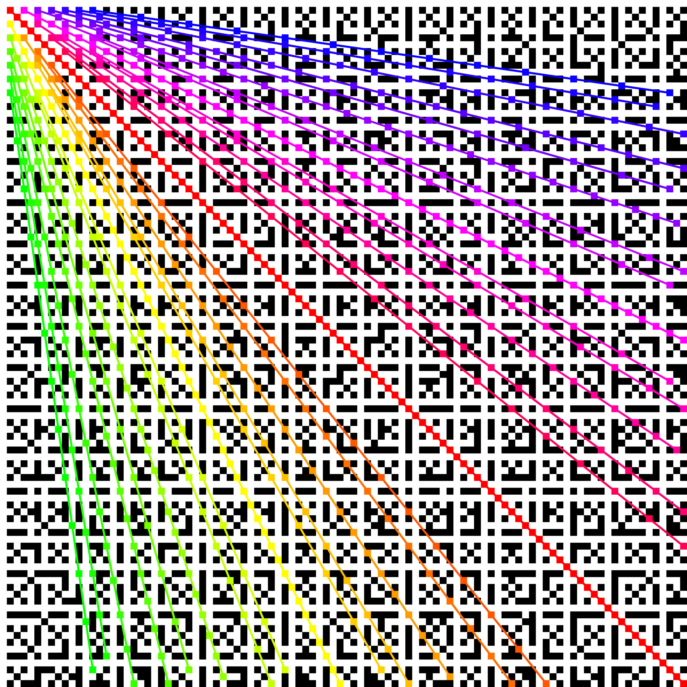
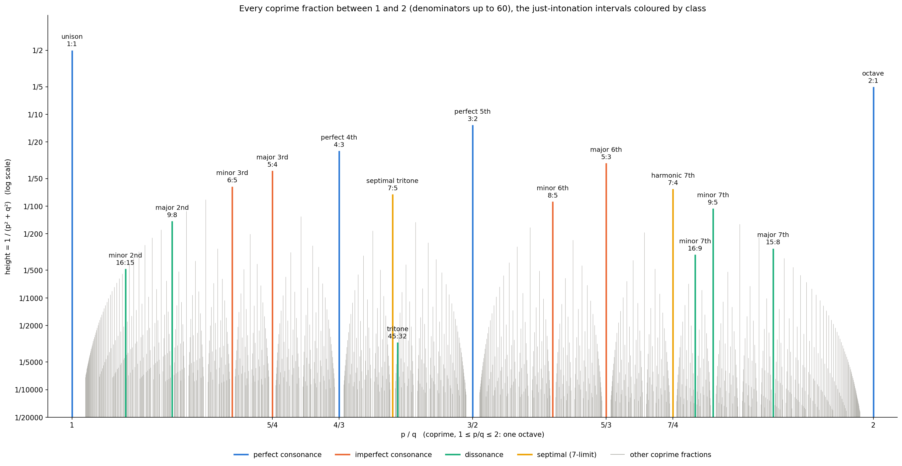
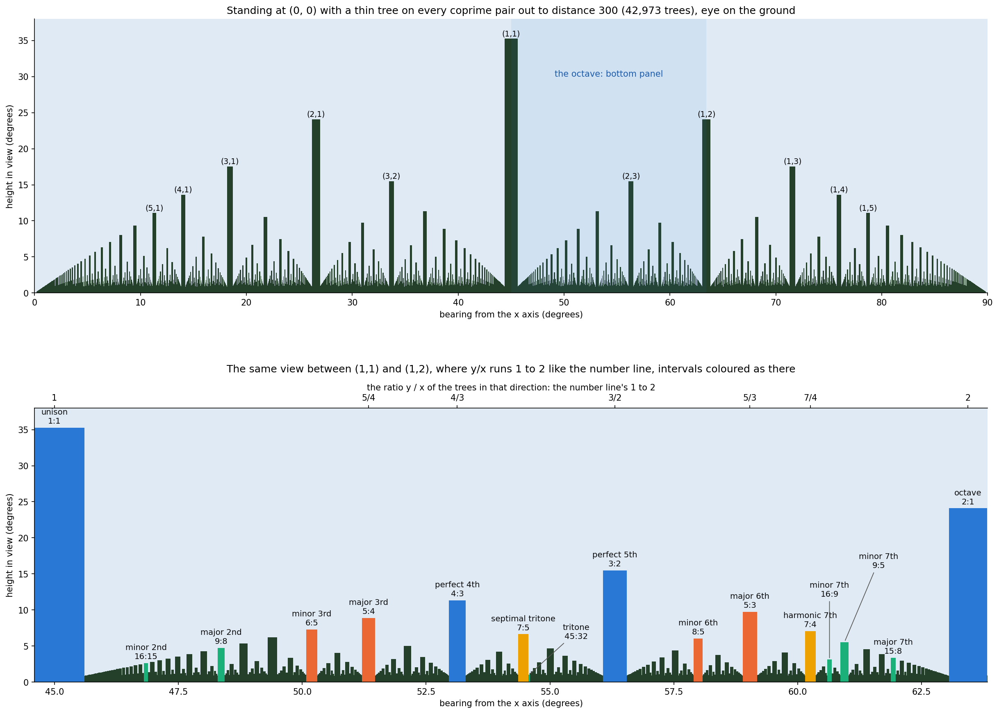

# Coprime pairs and musical intervals

**[Open the page](https://gernreich.github.io/coprime-intervals/)**: pick any
square of the grid to see its ray, the Turk's head knot it makes and its
Lissajous figure turning.

## One idea, five views

Everything here is one question asked several ways: **is the ratio a : b in
lowest terms?**

| | Coprime a : b | a : b with a common factor d | What makes it simple |
|---|---|---|---|
| Grid | a white square, the first point of its ray | a black square, point d of the ray a/d : b/d | near the corner |
| Music | an interval, frequencies in the ratio a : b | the same interval as a/d : b/d | small a and b: more shared overtones, more consonant |
| Turk's head | a leads, b bights, one strand | d separate strands, each an a/d × b/d pattern | few leads and bights |
| Lissajous | one closed curve, touching each side a times and the top b times | the a/d : b/d curve traced d times | few lobes, a steady figure |
| Orchard | a tree you can see from (0, 0) | hidden behind the tree at (a/d, b/d) | near you, so tall in view |

- **Coprime pairs** are fractions already in lowest terms. Every other pair
  is a multiple of one, which is why the black squares line up in rays from
  the corner: a whole ray is one ratio.
- **Musical intervals** are those ratios heard as pitch. Two notes a : b
  apart line up every a cycles of one and b of the other, so small coprime
  numbers sound smooth: 1:1, 2:1, 3:2, 4:3, 5:3, 5:4… in the order of the
  number line's heights.
- **Turk's heads** are the same ratio wound on a drum: a passes round, b
  scallops at each edge. One strand closes up exactly when a and b are
  coprime; a common factor d leaves d loops.
- **Lissajous figures** are the same drum seen from the side. x = sin(a·t + δ),
  y = sin(b·t): the point goes round the drum a times while it rises and
  falls b times. Two tones a : b on an oscilloscope draw that wire; the
  closed figure is the one-strand Turk's head without the over and under,
  and a slight mistuning makes δ drift, which turns the drum. Tune exactly
  and it stands still; the simpler the interval, the simpler the figure.

Two pictures of one fact. A pair of whole numbers (x, y) is **coprime** when
gcd(x, y) = 1, that is, when x/y is already in lowest terms. Put the coprime
pairs on a grid and they form rays from the corner. Put the fractions between 1
and 2 on a number line and they are the intervals inside one octave.

Everything here is made by one script:

```
python3 coprime_intervals.py
```

It writes the four images below and prints the ranking table. The page,
`index.html`, is written by hand and published by GitHub Pages; its
explorer draws the Turk's head and the turning Lissajous figure live. It needs
Python 3 with numpy, matplotlib and Pillow. The images are saved with no
metadata.

## The grid



`images/grid-100.png`: x runs 1 to 100 left to right, y runs 1 to 100 top to
bottom, each pair a 20px block. A block is white when x and y are coprime and
black when they share a factor. About 61% of the blocks are white, close to
6/π² ≈ 60.8%, the probability that two random whole numbers are coprime.
`images/grid-3840x2160.png` is the same picture at one pixel per pair, the
size of a 4K screen.

**The rays.** Take any step p across and q down with gcd(p, q) = 1. The
points (2p, 2q), (3p, 3q), (4p, 4q)… have gcd 2, 3, 4…, so every one is
black: each coprime step makes a black ray out of the corner (0, 0). The
first point, (p, q) itself, is white. The 1:1 ray is the diagonal, red here.
The 29 rays with both steps at most 7 and the smaller at most 4 are drawn in
colour, by angle: blue along the top, green down the left side, red on the
diagonal.

Lines from (1, 1) instead of from (0, 0) come out white: (1 + 2k, 1 + k), for
example, always has gcd 1.

## Turk's head knots

A Turk's head knot is described by its **leads**, the number of times the
strand passes round, and its **bights**, the scallops at each edge. A Turk's
head with L leads and B bights ties with a single strand exactly when
gcd(L, B) = 1. Otherwise it falls apart into gcd(L, B) separate loops.

So the white squares of the grid are the Turk's heads that work, read as x
leads and y bights. The black rays are the ones that don't: the point
k·(p, q) on a ray makes k separate strands, each tracing the (p, q) pattern
turned a little. The [knotwork sound-hole
generators](https://gernreich.github.io/knotwork-soundholes/) use exactly
this rule: the single-strand generator refuses a pair that isn't coprime.

## The number line



`images/number-line.png` shows every coprime fraction p/q from 1 to 2 with
denominator up to 60 (1103 of them). Each one has a vertical line of height
1/(p² + q²), on a log scale so the short ones show. The just-intonation
intervals are coloured by their traditional class and named.

The pattern repeats at every scale: each tall line stands in a gap with
smaller arches either side. The gaps are real (no fraction with a small
denominator lies close to a simple one like 3/2), but their width here comes
from stopping at denominator 60.

**6/π² again.** Of all the fractions p/q between 1 and 2 with q up to Q,
the share already in lowest terms tends to 6/π², the same density as the
grid's white blocks: 1103 of 1890 (58%) at Q = 60, 304,193 of 501,500
(60.7%) at Q = 1000. So the number of lines is about 3Q²/π² (1094 for
Q = 60). The figure also goes the other way round: 6/π² = 1/ζ(2), where
ζ(2) = 1 + 1/4 + 1/9 + … = π²/6.

The author found this ratio, π² : 6, independently at the age of 14.

## Standing in the orchard



`images/orchard.png`: stand at (0, 0) and put a thin tree, one unit tall, on
every coprime pair out to distance 300, eye on the ground. This is
**Euclid's orchard**. No tree hides another, since each coprime point is the
first on its ray, and the trees left out are exactly the ones that would
have been hidden: a full orchard looks just the same from here. The bottom
panel is the stretch between the trees at (1, 1) and (1, 2), where the ratio
y/x runs 1 to 2 left to right, just as the number line does.

The orchard is the number line seen in perspective:

- **Direction is the ratio.** The tree at (x, y) stands at bearing
  atan(y/x). Between (1, 1) and (1, 2), 45° to 63.4°, you see every ratio
  y/x from 1 to 2 in order: the octave. The fifth, 3:2, is the tree at (2, 3),
  at 56.3°; the fourth, 4:3, is the tree at (3, 4), at 53.1°.
- **Size is the height.** A tree at distance d = √(p² + q²) is about 1/d tall
  in view and 1/d wide, so the share of the view it fills is 1/(p² + q²):
  the height of its line on the number line. On a log scale the two have the
  same shape, since log(1/d²) is twice log(1/d).
- **The avenues are the gaps.** Beside each near tree a clear avenue runs
  almost to the horizon: the gaps either side of each tall line.
- **A flat window gives the Greek measure.** Trace the trees onto a window
  along the line x + y = 1: the tree at (p, q) lands at p/(p + q) with
  height 1/(p + q). That is Thomae's function, and p + q is the Pythagorean
  measure.
- **The far trees make a wall.** However thin the trees, enough of them far
  enough out cover the horizon: the dark band at the bottom, and the dense
  floor of the number line (Pólya's orchard problem).

## Does the height order the intervals by consonance?

Very nearly. Sorted by p² + q², the intervals come out unison, octave, fifth,
fourth, major sixth, major third, minor third, minor sixth: the order
Helmholtz gave for the consonances in *On the Sensations of Tone* (1863).
Dissonances follow, with the minor second near the end and the tritone last.
The two ratios with a 7 in them (7:4 and 7:5) come in above the minor sixth.
Western 12-tone music has no 7-based ratios, so the usual lists leave them
out.

Simple ratios sound smooth because two notes in the ratio p:q share
overtones: their waveforms line up every p cycles of one and q cycles of
the other. Smaller numbers mean more shared overtones and less beating.

Four rules for "how simple is p:q", each interval's score and, in brackets,
its rank (equal scores share a rank):

| Interval | Ratio | p²+q² | p+q (Pythagorean) | p·q (Tenney) | Euler gradus |
|---|---|---|---|---|---|
| unison | 1:1 | 2 (1) | 2 (1) | 1 (1) | 1 (1) |
| octave | 2:1 | 5 (2) | 3 (2) | 2 (2) | 2 (2) |
| perfect 5th | 3:2 | 13 (3) | 5 (3) | 6 (3) | 4 (3) |
| perfect 4th | 4:3 | 25 (4) | 7 (4) | 12 (4) | 5 (4) |
| major 6th | 5:3 | 34 (5) | 8 (5) | 15 (5) | 7 (5) |
| major 3rd | 5:4 | 41 (6) | 9 (6) | 20 (6) | 7 (5) |
| minor 3rd | 6:5 | 61 (7) | 11 (7) | 30 (8) | 8 (6) |
| harmonic 7th | 7:4 | 65 (8) | 11 (7) | 28 (7) | 9 (7) |
| septimal tritone | 7:5 | 74 (9) | 12 (8) | 35 (9) | 11 (9) |
| minor 6th | 8:5 | 89 (10) | 13 (9) | 40 (10) | 8 (6) |
| minor 7th | 9:5 | 106 (11) | 14 (10) | 45 (11) | 9 (7) |
| major 2nd | 9:8 | 145 (12) | 17 (11) | 72 (12) | 8 (6) |
| major 7th | 15:8 | 289 (13) | 23 (12) | 120 (13) | 10 (8) |
| minor 7th | 16:9 | 337 (14) | 25 (13) | 144 (14) | 9 (7) |
| minor 2nd | 16:15 | 481 (15) | 31 (14) | 240 (15) | 11 (9) |
| tritone | 45:32 | 3049 (16) | 77 (15) | 1440 (16) | 14 (10) |

- **p + q.** Ptolemy (*Harmonics* I.5–6) reports and criticises a
  Pythagorean measure: take the ratio in lowest terms, subtract one from
  each term and add what is left; the smaller the sum, the better the
  consonance. That is p + q − 2, so it orders exactly as p + q. It gives
  octave 1, fifth 3, fourth 5. (Recalled from Barker's translation in
  *Greek Musical Writings* II; worth checking against the text.)
- **p · q.** Tenney height, from the 20th century; usually quoted as
  log₂(p·q). It puts 7:4 ahead of 6:5.
- **Euler's gradus suavitatis** (1739): 1 plus the sum of (prime − 1) over
  the prime factors of p·q, with repeats. Coarse, so many ties, and it rates
  9:8 as smooth as the minor sixth.
- **p² + q²** is the same as (p − q)² + 2pq: Tenney's measure plus a penalty
  for wide intervals. The four rules agree on the first six places.

The Greeks didn't rank all these intervals. The Pythagoreans counted only
the octave, fifth and fourth and their octave compounds as consonant: ratios
that are *multiple* (n:1) or *superparticular* ((n+1):n) and built from 1, 2,
3 and 4. Ptolemy broke with them over the octave plus a fourth
(8:3), which he heard as consonant though it is neither. Thirds and sixths
were counted as consonances only from the Middle Ages on.

Two limits. These are just-intonation ratios: equal temperament only comes
close (a piano's major third is 400 cents, 5:4 is 386). And how consonant
an interval sounds also depends on register, timbre and context, which no
formula sees.

## Licence

[CC0 1.0](LICENSE): public domain.
